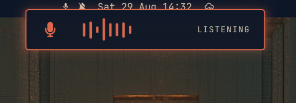
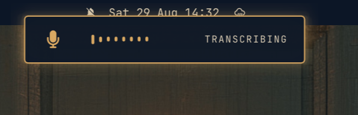
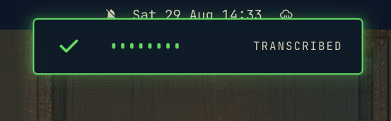

# Voxtype Aura

A compact, theme-aware [Voxtype](https://github.com/peteonrails/voxtype)
dictation overlay for [Omarchy](https://omarchy.org/).

Aura appears at the top-center of the focused monitor while Voxtype is active:

- **LISTENING** with live microphone-level bars while recording.
- **CHECKING MIC** while the actual capture route is being verified.
- **MIC MUTED** with a crossed-out microphone when that input is muted.
  The recording is cancelled without transcription; unmute and press the hotkey again.
- **CHECK MIC** if the capture route cannot be verified within 1.5 seconds.
- **TRANSCRIBING** with a sweeping animation while processing speech.
- **TRANSCRIBED** with a brief check mark after successful transcription.
- Hidden when Voxtype is idle.

It follows Omarchy's active colors, typography, spacing, and corner radius. The
layer-shell surface never takes keyboard focus, accepts no pointer input, and
does not reserve screen space.

## Examples

### Listening



### Transcribing



### Transcribed



## Requirements

- Omarchy with shell-plugin support.
- Voxtype running as `voxtype.service`.
- `omarchy-voxtype-status` available on `PATH`.
- `voxtype-audio-bridge` available on `PATH`.
- Quickshell's `Quickshell.Services.Pipewire` module and a PipeWire-visible
  Voxtype capture stream.
- Voxtype with support for `voxtype record cancel`.

## Install

Disable Voxtype's built-in OSD in `~/.config/voxtype/config.toml`:

```toml
[osd]
enabled = false
```

Restart Voxtype:

```sh
systemctl --user restart voxtype.service
```

Install and enable Aura:

```sh
omarchy plugin add https://github.com/adamcbrewer/voxtype-aura.git --enable
```

## Remove

```sh
omarchy plugin remove io.github.adamcbrewer.voxtype-aura
```

To restore Voxtype's built-in display, set `[osd] enabled = true` and restart
`voxtype.service`.

## How It Works

Aura is a keep-loaded Omarchy service plugin. It follows Voxtype's status stream
through `omarchy-voxtype-status` and reads live microphone levels from
`voxtype-audio-bridge`. A valid transition from `transcribing` to an
inactive state briefly shows the completion state. Unexpected or unavailable
status data fails closed by hiding the overlay. If either process exits while
needed, Aura retries it after one second.

### Microphone guard

Before showing LISTENING, Aura resolves Voxtype's live capture stream and its
connected source, rather than assuming the system default is the microphone in
use. It checks both stream and source mute state every 50 ms during recording.
A muted input cancels via `voxtype record cancel`, keeps the warning visible for
3.5 seconds, and suppresses the normal transcription/success display. It never
automatically unmutes a device. All existing Voxtype hotkeys remain unchanged.

Mute detection requires a PipeWire-visible capture route. Hardware mute switches
that do not report their state to PipeWire cannot be detected this way. Direct
ALSA capture outside PipeWire is not supported by this guard and displays CHECK MIC.
Quickshell's PipeWire service supplies the [node mute state](https://quickshell.org/docs/v0.3.0/types/Quickshell.Services.Pipewire/PwNodeAudio/).

Run regression checks with `node tests/microphone.test.cjs`. Because this plugin
uses `keepLoaded`, run `omarchy restart shell` after changing its code if a plugin
rescan retains the previous instance.

## Credits

Voxtype Aura was inspired by Jon Henshaw's
[Voxtype Prism](https://github.com/jonhenshaw/voxtype-prism), particularly its
compact, theme-aware recording indicators and Omarchy layer-shell integration.
See [THIRD_PARTY_NOTICES.md](THIRD_PARTY_NOTICES.md) for license attribution.

## Security

Omarchy plugins run unsandboxed inside the long-lived `omarchy-shell` process.
Review plugin code before enabling it. Aura runs fixed local status/audio commands
and `voxtype record cancel` when input is muted or unavailable,
accepts no user input, performs no network requests, and reads no credentials.

## License

[MIT](LICENSE)
